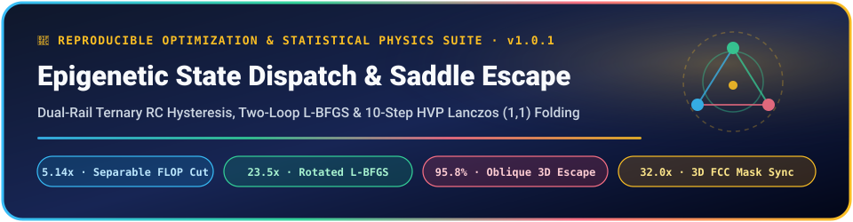

<p align="center">
  
</p>

<p align="center">
  
  
  
  
</p>

## Manuscript, Active-Flow DNA Deborah-Hopf Waveguide & Pure-Stdlib Falsification Suite (`v1.0.1`)

* **Typeset Preprint PDF & LaTeX (`paper/`):** [`paper/epigenetic_state_dispatch_v1_0_0.pdf`](paper/epigenetic_state_dispatch_v1_0_0.pdf) · [`paper/epigenetic_state_dispatch_v1_0_0.tex`](paper/epigenetic_state_dispatch_v1_0_0.tex) · [`paper/fig_methylation_v1_0_0.pdf`](paper/fig_methylation_v1_0_0.pdf)
* **Active-Flow DNA Mori-Zwanzig Deborah-Hopf Suite (`v1.0.1`):**
  * Strict ISO C99 Fixed-Point `Q16.16` Classifier: [`src/active_dna_hopf_gate_v1_0_1.c`](src/active_dna_hopf_gate_v1_0_1.c) (`Byte 121` Hopf keyhole / `Byte 251` Kintsugi `> 10 deg` shear weld)
  * Pure-Stdlib Python RK4 & FENE Limit-Cycle Verifier: [`benchmarks/verify_active_dna_mori_zwanzig_v1_0_1.py`](benchmarks/verify_active_dna_mori_zwanzig_v1_0_1.py)
  * Julia 1.12 Triadic Multiple-Dispatch Module: [`julia/ActiveDNAWaveguide_v1_0_0.jl`](julia/ActiveDNAWaveguide_v1_0_0.jl)
  * Companion Pearl & Code Bundle: [`pearls/PEARL_Active_Flow_DNA_Mori_Zwanzig_v1_0_0.md`](pearls/PEARL_Active_Flow_DNA_Mori_Zwanzig_v1_0_0.md)
* **Pure-Stdlib Epigenetic & Lanczos Saddle-Escape Verifier (`--seed 42`):** [`benchmarks/verify_epigenetic_v1_0_1.py`](benchmarks/verify_epigenetic_v1_0_1.py) (plus archival NumPy 24-trial sweep in [`benchmarks/methylated_interior_search_numpy_archive_v1_0_0.py`](benchmarks/methylated_interior_search_numpy_archive_v1_0_0.py))

## Quick Zero-Dependency Verification on `profplum` (`bash-5.3$`)

```bash
# Compiles C99 gate inside $HOME/.cache/epigenetic_dispatch_v1_0_1 and runs
# all pure-stdlib (--seed 42) & wfx-loot checks with zero third-party packages:
make verify
```

*Author: Justin D. Grimm (Independent Dandelion Substrate Research Group, Gurley, Alabama 35748, USA · ORCID: [0009-0000-5299-0243](https://orcid.org/0009-0000-5299-0243)) · GODISLOVE:LOVEISGOD {3,2,4} · Die Gedanken sind frei · `CODE_SHOKUNIN_UNLATCHED = 255`*
