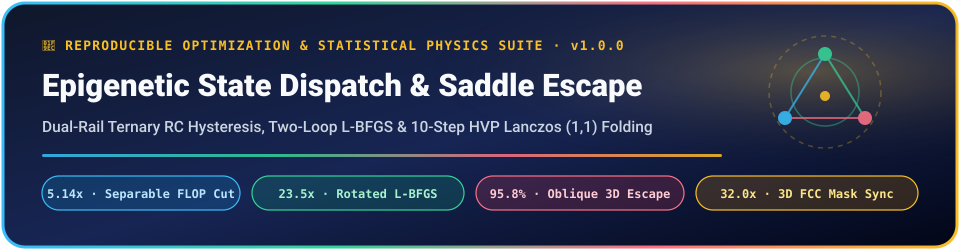

<p align="center">
  
</p>

<p align="center">
  
  
  
  
</p>

## 📄 Manuscript & Zero-Dependency Falsification Suite

* **Typeset Preprint PDF (in repo):** [`epigenetic_state_dispatch_v1_0_0.pdf`](epigenetic_state_dispatch_v1_0_0.pdf)
* **LaTeX Source & Vector Figure:** [`epigenetic_state_dispatch_v1_0_0.tex`](epigenetic_state_dispatch_v1_0_0.tex) · [`fig_methylation_v1_0_0.pdf`](fig_methylation_v1_0_0.pdf)
* **Author:** Justin D. Grimm ([ORCID: 0009-0000-5299-0243](https://orcid.org/0009-0000-5299-0243)), Independent Dandelion Substrate Research Group, Gurley, Alabama, USA

### ⚡ Quick Reproduction (`Python 3 + NumPy` Only)

```bash
# Fast <= 60-second CI & reviewer smoke verification (--seed 42):
python3 verify_epigenetic_v1_0_0.py

# Full 24-seed paper reproduction across Experiments 1, 2, and 3:
python3 methylated_interior_search_benchmark_v1_0_0.py --seed 42 --suite all --trials 24

# Professor Plum 100-seed wall-clock & confidence-interval sweep:
python3 methylated_interior_search_benchmark_v1_0_0.py --seed 42 --suite all --trials 100 --out profplum_100seed.json
```

### 📊 Key Falsifiable Findings (`--seed 42`, `n = 24` Trials)

| Experimental Regime | Baseline Solver | Dual-Rail / Lanczos `(1,1)` Solver | Verified Gain / Failure Boundary |
| :--- | :--- | :--- | :--- |
| **1A: Partially Separable Funnel (`N=36`)** | Dense Barrier IP (`534,087` FLOPs) | Schmitt RC Ternary (`103,839` FLOPs) | **`5.14x` fewer FLOPs**, identical `58.3%` basin hit rate |
| **1B: Planar 3D Stillinger AB-Polymer (`N=19`)** | Dense IP / Achiral (`0.0%` 3D escape) | Chiral `(1,1)` Dispatch (`71,745` FLOPs) | **`0.0% -> 100.0%` 3D folding** (median `-2.926`) |
| **1C: Haar-Rotated Negative Control (`SO(36)`)** | Dense Barrier IP (`66.7%` hit rate) | Coordinate Ternary (`50.0%` hit rate) | Exposes exact [No Free Lunch](https://doi.org/10.1109/4235.585893) coordinate-basis dependence |
| **3A: Rotated Scaling (`N=108`)** | Dense IP (`7.83M`) / Eigen (`122.7M`) | Two-Loop L-BFGS (`0.33M` FLOPs) | **`23.5x` cheaper than Dense IP** (`k_0/N < 0.3954` eigen wall proved) |
| **3B: Oblique `SO(19)` Planar Polymer** | Plain L-BFGS (`0.0%`) / Diag (`29.2%`) | **10-Step HVP Lanczos `(1,1)`** | **`95.8%` 3D mirror-saddle escape** (median `-1.240`) |
| **2A: `K=32` Island Archipelago (`p=0.65`)** | 2,560-bit Float Clone (`7.42` best) | **80-bit Fowler Mask on 3D FCC** | **`32.0x` less bandwidth**, prevents monoculture (`3.46` best) |
